# Route Planner — user guide

How to do each task in the Route Planner (v0.10.0). The screenshots come from the **demo week** in [`demo/`](../demo/README.md), which is made-up data, so you can follow along and present it to the team without using company files.

**Contents**

1. [Start: users file, your name and the shared folder](#1-start-users-file-your-name-and-the-shared-folder)
2. [Load reports (a planning day)](#2-load-reports-a-planning-day)
3. [Open a saved plan](#3-open-a-saved-plan)
4. [Move orders](#4-move-orders)
5. [Defer orders](#5-defer-orders)
6. [Split a customer's orders](#6-split-a-customers-orders)
7. [Insert an order](#7-insert-an-order)
8. [Create a route](#8-create-a-route)
9. [Create a new day](#9-create-a-new-day)
10. [Edit or add customer details](#10-edit-or-add-customer-details)
11. [Docket type (Pink & White / Offloading)](#11-docket-type-pink--white--offloading)
12. [Change report and exporting changes](#12-change-report-and-exporting-changes)
13. [Save and share](#13-save-and-share)
14. [Customize (Master only)](#14-customize-master-only)
15. [Roles: who can do what](#15-roles-who-can-do-what)

---

## 1. Start: users file, your name and the shared folder

When the app opens, it asks **who is planning**.

1. The first time on a computer, click **📄 Load users file…** and choose `users.json`, which is usually in `MASTER_DATA`. The file lists everyone's name and role, and the app remembers it.
2. Click your name. Your role is shown next to it.
3. The first time, the app asks you to **link the shared folder**. Click **Choose folder…** and pick the `Route_planning` folder. The window shows the folder your users file expects.
4. That's it. The **customer master** and the **fixed routes** are read automatically from `MASTER_DATA`, and they're read again only when those files change.

| Home page | Link the folder |
|---|---|
| 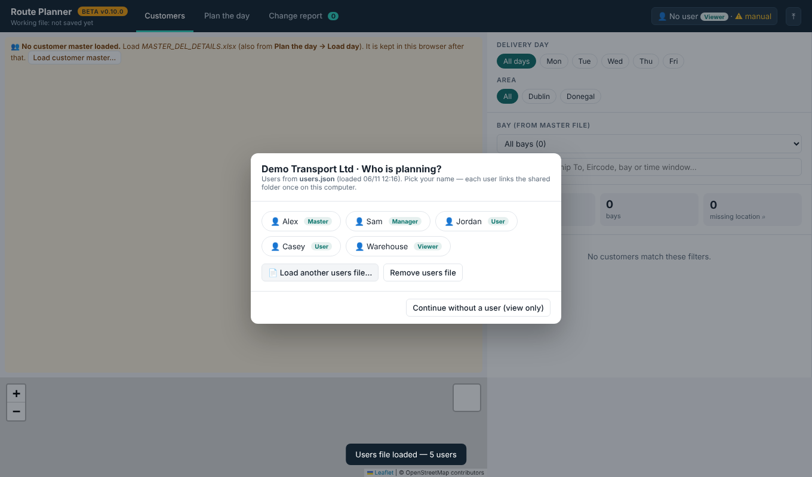 | 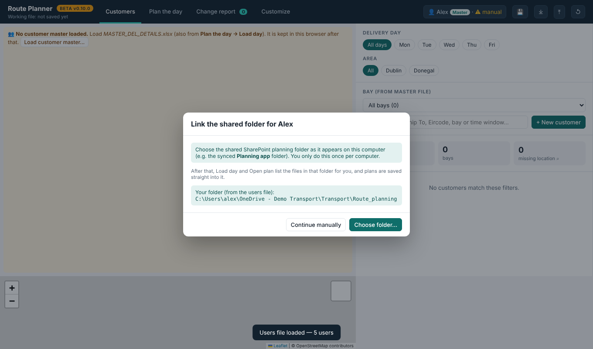 |

> Without a users file the app runs in **open mode**, where everyone can do everything. That's useful for trying it out.
> The 👤 button at the top shows your name, your role and the linked folder. Click it to switch user, change the folder or (Master and Manager only) manage users.

## 2. Load reports (a planning day)

Reports live in `REPORTS/week_XX/`, e.g. `DIPS_Plan_Mon.xlsx` and `RES_Mon.xlsx`.

1. Go to **Plan the day** and click **⤒ Load day**.
2. The window opens on the **newest week** (use the week chips to switch). Files are grouped as DIPS Plan, Resources, Products, Uplifts, POD, Customer master and Fixed routes. Each one shows its day, worked out from the week folder and the weekday in the name.
3. Tick the DIPS Plan and Resources files for the days you want. You can load several days at once, or Resources on their own to create or update a day.
4. Click **Import selected**. Check the preview (routes, drops, orders, kg, how many are on the map, and any warnings), then click **Add**.

| Choose files | Preview |
|---|---|
| 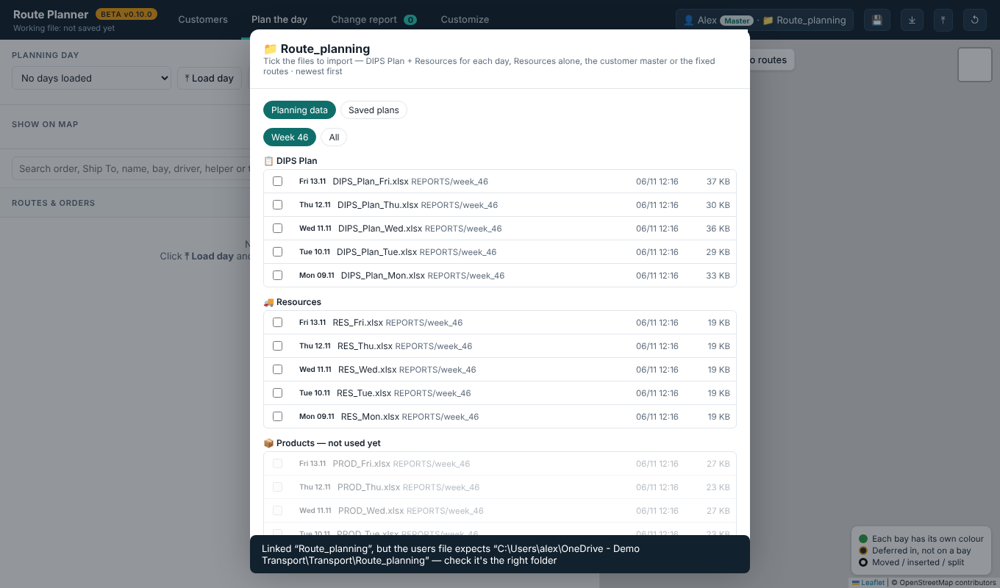 | 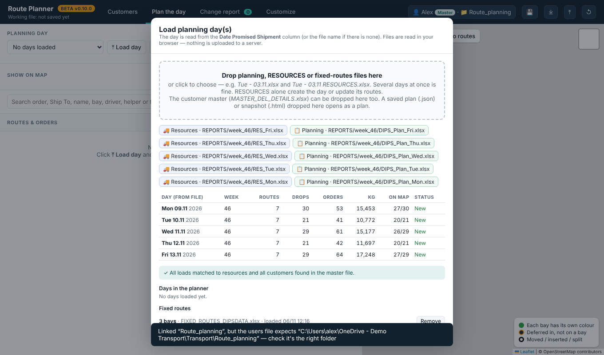 |

> Products, Uplifts and POD are listed but can't be imported yet.
> Without a linked folder, drop the files onto the window or click to choose them.

## 3. Open a saved plan

1. Click **⤒ Open plan** (top right).
2. Pick the week, then the plan file (`.json`) from `PLANS/week_XX`, and click **Open plan**.
3. Check who saved it and when, then click **Open this plan**. It replaces what's in your planner, so save your own work first if you need it.

> A **snapshot** (`.html`) opens with a double-click. It's view-only, for people who just need to look at or print the plan.

## 4. Move orders

**One drop** (a customer on a route):

1. In **Plan the day**, open the route (or click **Expand all**).
2. Click **Move** on the drop, choose the new route, a reason and an optional note.
3. The window shows the effect on the destination bay (drops and kg). Click **Move**.

**A group:**

1. Tick the drops (or use **▭ Select area** on the map to draw around them).
2. Click **Move** in the bar at the bottom and continue as above.

| One drop | Group selected |
|---|---|
| 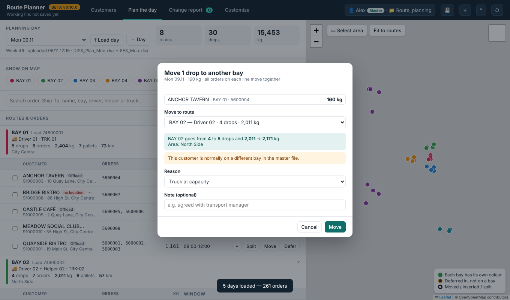 | 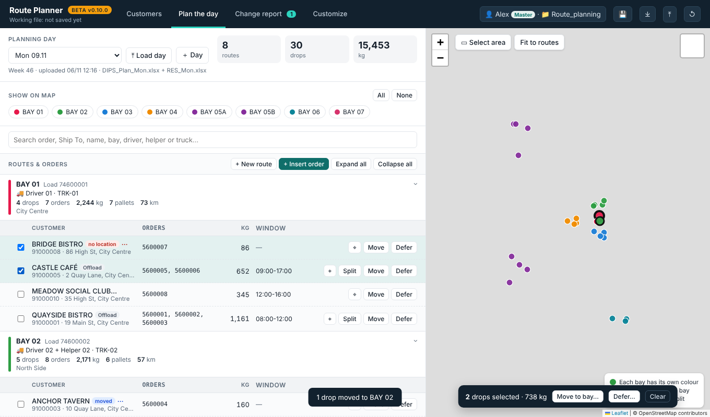 |

## 5. Defer orders

**One drop:**

1. Click **Defer** on the drop.
2. Pick the day on the calendar. Days whose files are loaded are highlighted, and the customer's usual days are marked.
3. If that day is loaded, choose a **bay** now or leave it unassigned. Add the reason, then click **Defer**.

**A group:** tick the drops, click **Defer** in the bottom bar and continue as above.

| One drop, onto a bay | Group, no bay yet |
|---|---|
| 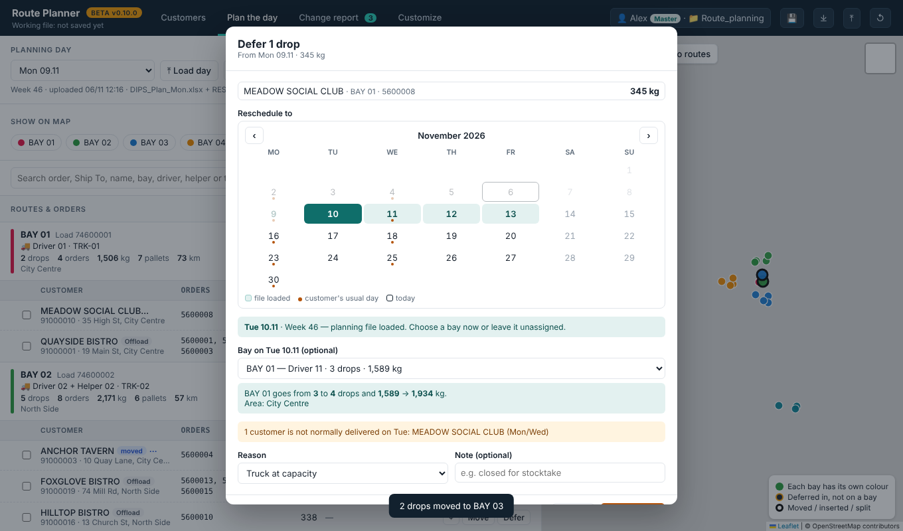 | 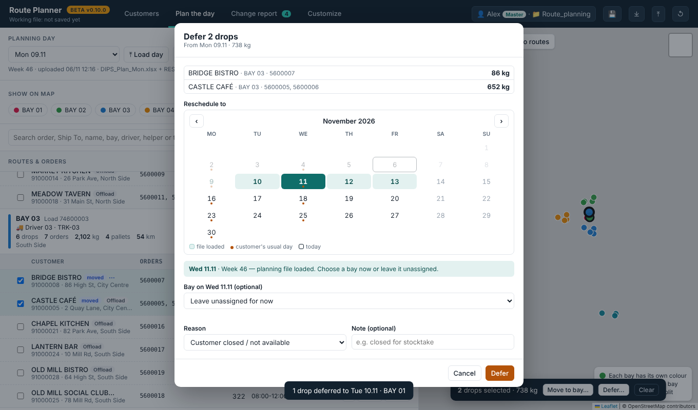 |

**Later:** drops deferred without a bay wait in the change report under **Deferred — not on a bay yet**. Tick them and click **Allocate**. The original line in **Deferred orders** is then updated with the day and bay they ended up on. It doesn't appear again as a reallocation.

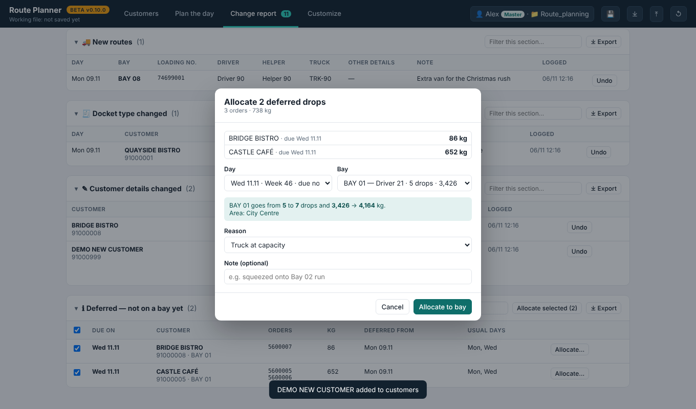

## 6. Split a customer's orders

1. Click **Split** on a drop that has more than one order.
2. Tick the orders that go on a **new line**.
3. Choose the **docket type for each line** (new line and remaining line), then click **Split**.
4. Each line can now be moved or deferred on its own. **Merge** puts them back together.

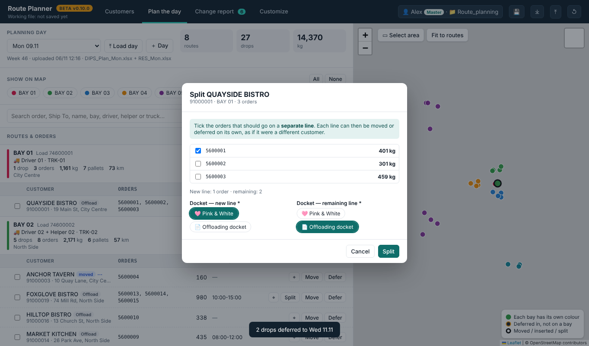

## 7. Insert an order

1. Click **+ Insert order**.
2. Enter the order number and the Ship To (type the number or start typing a name). The customer's details and usual bay fill in.
3. Choose the bay and, if you like, the weight, address and note.
4. Choose the **docket type** (required): 🩷 Pink & White or 📄 Offloading. Then click **Insert order**.

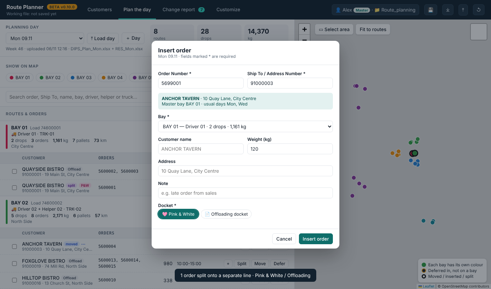

## 8. Create a route

1. Click **+ New route**.
2. Fill in bay, loading number, driver, helper and truck (required), plus pallets, km, area and note (optional).
3. Click **Add route**. It appears on the day and in the change report under **New routes**.

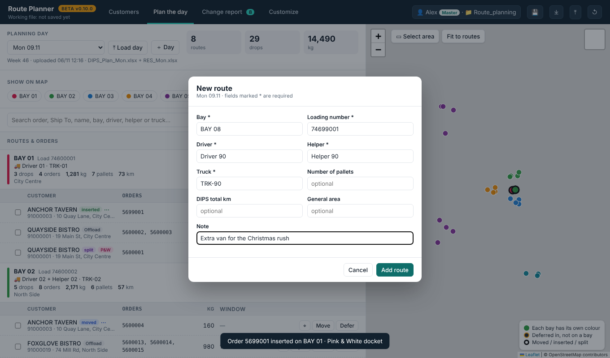

## 9. Create a new day

1. Click **＋ Day** next to the day list.
2. Pick the date. The window shows which **fixed routes** run that weekday.
3. Click **Create day**. When its DIPS Plan and Resources files arrive, load them and they fill in the same day.

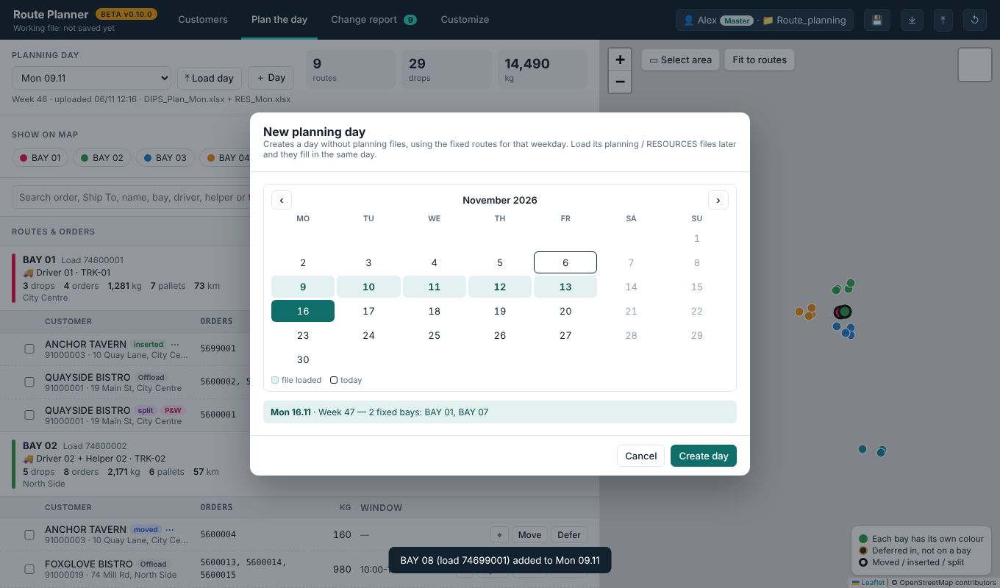

## 10. Edit or add customer details

**Edit:** on the **Customers** map, click a customer and then **✎ Edit details**. Or click a customer in the list that has no location. You can change the name, address, Eircode, bay, delivery days and time window. To fix the location, type the coordinates, click the small map, drag the pin, or search the address / Eircode.

**Add:** click **+ New customer** and fill in the Ship To and details.

Customer changes are listed in the change report. The master file isn't changed, so the edits are what staff copy into the other systems.

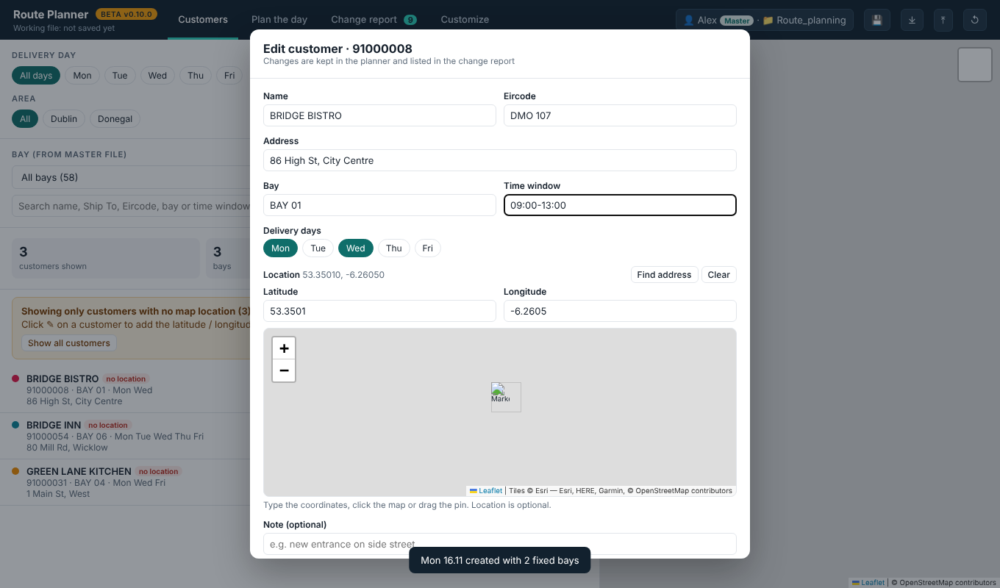

## 11. Docket type (Pink & White / Offloading)

Every order has a docket type:

- **From the planning file:** always **Offloading**.
- **Inserted orders:** you choose when inserting (required).
- **Split lines:** you choose for each line when splitting.

You can change it in the **Change report**:

- **Any order:** type the order number in the 🧾 **Docket type** box at the top and click **Change…**.
- **Orders in the tables:** click its tag (**Offload** / **P&W**).

Each change is listed under **Docket type changed** and can be undone. The plan shows the tag on every line.

## 12. Change report and exporting changes

The **Change report** tab lists every change, with the order numbers staff need in order to update the other systems.

- **Sections:** Deferred, Reallocated, Inserted, New routes, Route details from RESOURCES, Docket type, Customer details and Deferred not on a bay yet.
- **Boxes at the top** show only that section (click again to show everything).
- **Search** looks across everything, including driver, helper and truck. **Filter this section** works within one section.
- **Click a column heading** to sort that section (click again to reverse).
- **Undo** removes a change. If something happened to those orders later, undo that first.
- **⤓ Export** on a section, or the export button at the top for everything, creates an Excel file. **Print** prints the report with a signature line.

| Report | After allocating and sorting |
|---|---|
| 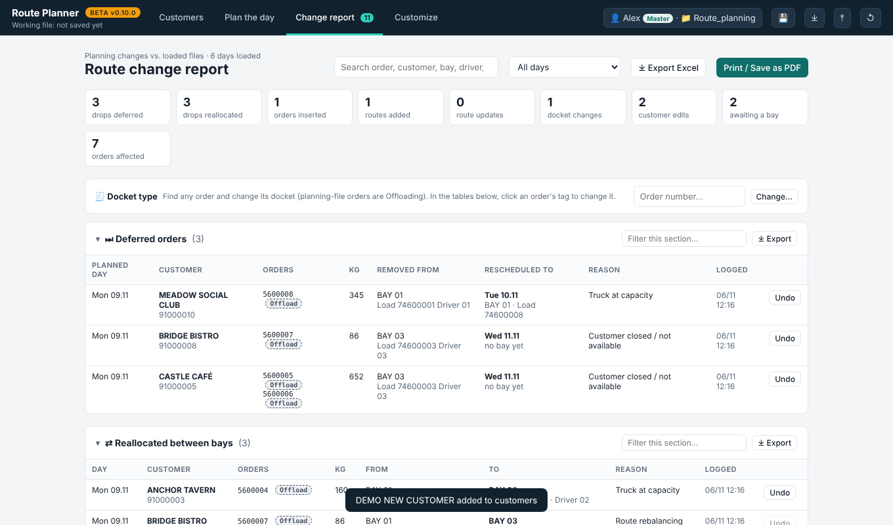 | 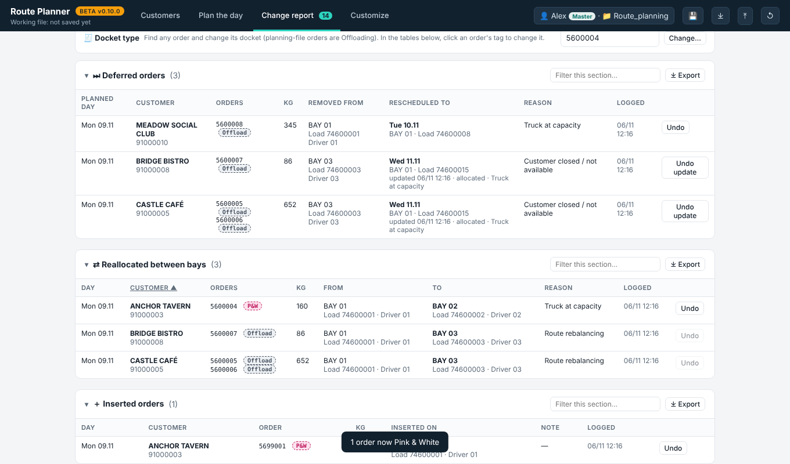 |

## 13. Save and share

- **💾 Save** (top right) saves the plan file straight into `PLANS/week_XX`, using the week of the day you're planning. The name is `version_date_time_user`, e.g. `v0.10.0_2026-11-06_16.05_Alex.json`.
- **⤓ Save as / share** gives two options:
  - **Plan file (.json):** for planners who'll keep working on it. **Save** or **Save as…** to choose another place.
  - **Snapshot (.html):** a view-only copy anyone can open with a double-click.
- The line under the app name shows the file you're working on. Click it to see the history (each file remembers the one it was based on).

**↺ Reset** (Master and Manager) resets the **whole application** on this computer. It clears:
- the plan and loaded days;
- the customer master and fixed routes;
- customer edits;
- the users file and shared-folder links.

The app then reopens on the home page, ready to load the users file again. Files in the shared folder aren't touched, so save first if you want to keep the plan.

## 14. Customize (Master only)

The **Customize** tab is only visible to Master users. Changes are saved with the plan.

- **Bay colours:** pick a colour for each bay, used on both maps and the route list. **Default** goes back to the automatic colour.
- **Route names for one day:** give a route a name for one day only, e.g. "City Express" instead of BAY 01.

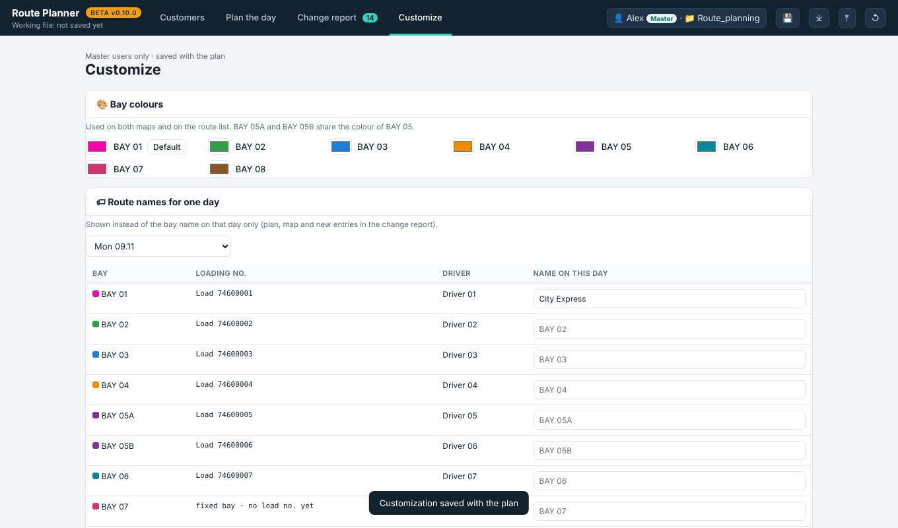

## 15. Roles: who can do what

| | Master | Manager | User | Viewer |
|---|:-:|:-:|:-:|:-:|
| View plans, maps and report; print and export | ✅ | ✅ | ✅ | ✅ |
| Load days, move, defer, split, insert, routes, days, customers, dockets, save | ✅ | ✅ | ✅ | — |
| Undo, remove days or fixed routes, full reset | ✅ | ✅ | — | — |
| Manage users (roles and folders) | ✅ | ✅ except Master users; can't add users | — | — |
| Add or remove users | ✅ | — | — | — |
| Customize tab | ✅ | — | — | — |

A **Viewer** sees the planner like a snapshot, with no editing buttons. Roles are guardrails for this prototype, not security; see [backend-blueprint.md](backend-blueprint.md).

| Viewer | Manage users (Manager) |
|---|---|
| 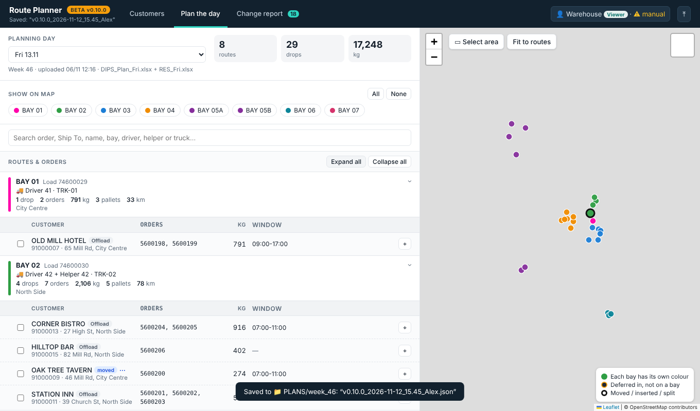 | 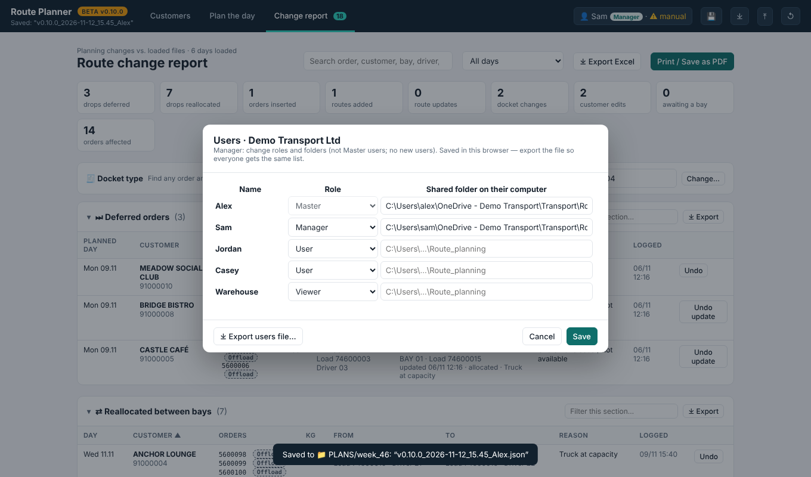 |
