# Route Planner — user guide

How to do each task in the Route Planner (v0.10.6). The screenshots come from the **demo week** in [`demo/`](../demo/README.md), which is made-up data, so you can follow along and present it to the team without using company files.

**Contents**

1. [Start: company folder, your name, computer / path / files check](#1-start-company-folder-your-name-computer--path--files-check)
2. [Load reports (a planning day)](#2-load-reports-a-planning-day)
3. [Open a saved plan](#3-open-a-saved-plan)
4. [Move orders](#4-move-orders)
5. [Defer orders](#5-defer-orders)
6. [Split a customer's orders](#6-split-a-customers-orders)
7. [Insert an order](#7-insert-an-order)
8. [Create a route](#8-create-a-route)
9. [Create a new day](#9-create-a-new-day)
10. [Edit or add customer details](#10-edit-or-add-customer-details)
11. [Docket type (P&W / Check Sheet)](#11-docket-type-pw--check-sheet)
12. [Change report and exporting changes](#12-change-report-and-exporting-changes)
13. [Save and share](#13-save-and-share)
14. [Customize (Master only)](#14-customize-master-only)
15. [Roles: who can do what](#15-roles-who-can-do-what)

---

## 1. Start: company folder, your name, computer / path / files check

The planner is **locked** when it opens. Nothing can be used, viewed or changed until you choose your name and pass the checks. The window can't be closed by clicking outside it, pressing Escape or using the keyboard.

1. **Link the company folder.** This is needed once per laptop. Click **📁 Choose folder…** and pick the shared `Route_planning` folder.
2. **Users file.** The app reads `users.json` from `MASTER_DATA`. If there are several, choose one.
3. **Who is planning?** Click your name. Everyone in the company is listed, but on a laptop that's already registered **only its owner can be chosen**; the other names are greyed out.
   - **🔄 Reload users file** reads `users.json` again from `MASTER_DATA`, e.g. after a Master changed it.
   - **Change users file…** picks another users file in `MASTER_DATA`.
4. **Checks, in order:**
   1. **Computer:** each laptop belongs to one person, and staff can't use another person's laptop.
      - **First time:** the laptop is registered to you when you continue.
      - **Afterwards:** only you can use it, and you can't use another laptop.
   2. **Path:** your folder is set in the users file, and the linked folder is your folder.
   3. **Files:** `MASTER_DATA` and `REPORTS` are there, plus the customer master and fixed routes.
5. **The result:**
   - **✅ Ready:** click **Continue** to open the planner, or **← Go back**.
   - **⛔ Check failed:** the planner stays locked.
     - **Someone else's laptop, or no folder set for you:** there's only **← Go back**. A Master or Manager has to fix it (see below).
     - **Wrong folder linked:** **Continue — choose the folder** lets you pick the right one.
6. **Master data & reports window.** After you continue, this window always opens (the customer master and fixed routes are read from `MASTER_DATA` first; if the folder has a changed version, the app shows what changed and asks before loading).
   - **Left, Master data:** the customer master and fixed routes found in `MASTER_DATA`.
   - **Right, Reports:** the DIPS Plan and RES files of the newest week in `REPORTS`.
   - Every file has the same tag as in **Load day**: **✓ loaded** (this exact file is in the planner), **⚠ the folder has a different version**, or **not loaded**. A line under Master data says whether the planner has the version found in the folder.
   - **Load master data** loads what is new or changed; **📁 Load reports…** opens Load day; **Continue** goes to the planner.
   - Open it again any time from 👤 → **Master data & reports…**.

**Company name.** It's read from `users.json` (`company`); if the file has none, it comes from the file's name (`users_Acme.json` → **Acme**). It's shown top left next to the version, as the heading of the start windows and in 👤 → **Manage users…** (a Master can change it there).

| Master data & reports | A master data file changed in the folder |
|---|---|
| 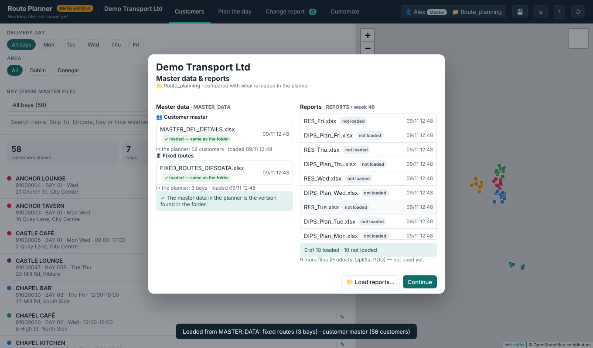 | 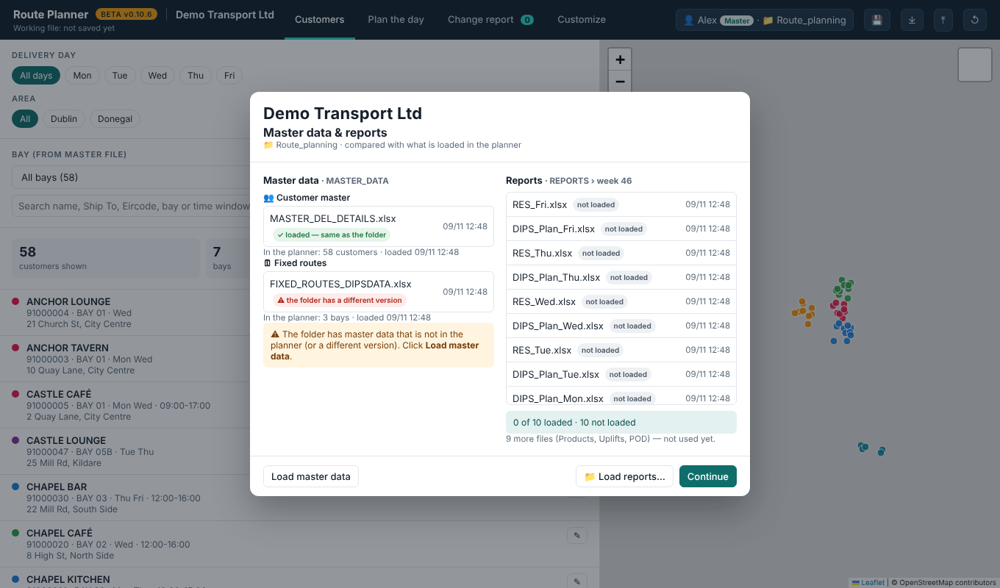 |

| Link the folder | Who is planning? | Checks |
|---|---|---|
| 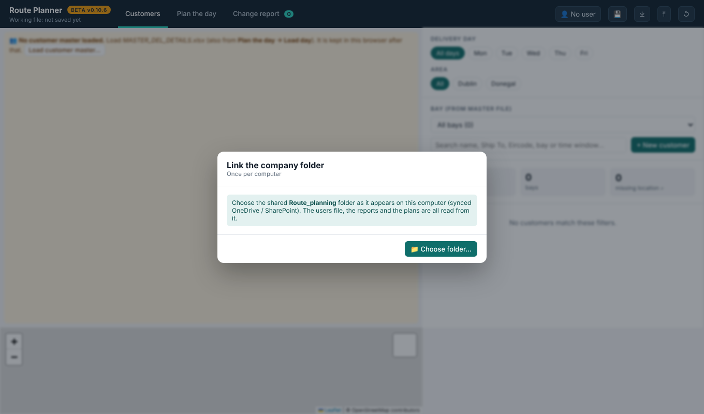 | 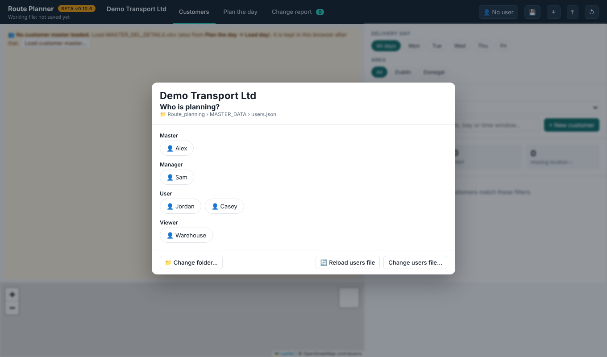 | 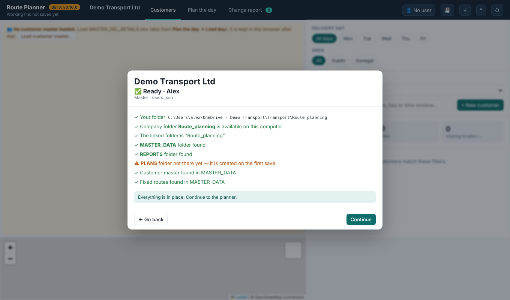 |

| A registered laptop shows only its owner | Your user on another laptop | No folder set: blocked |
|---|---|---|
| 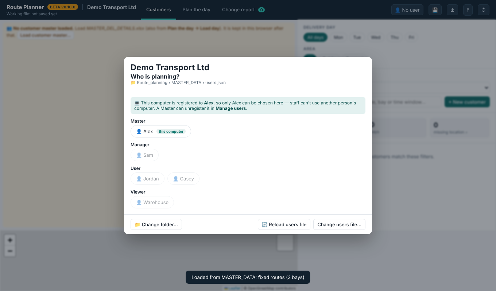 | 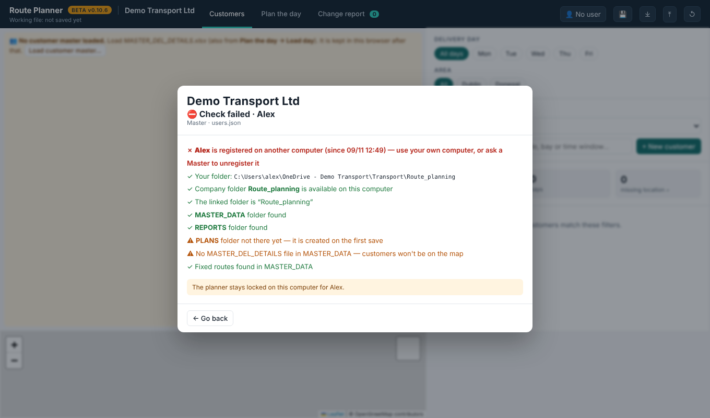 | 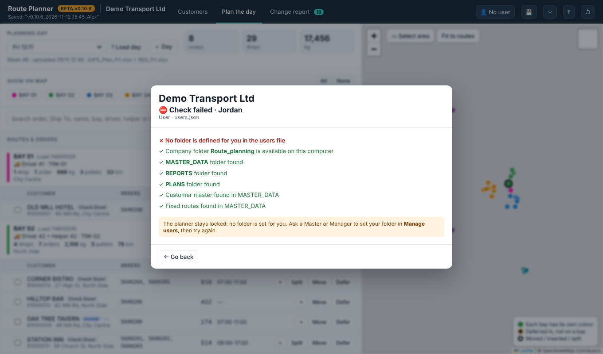 |

**Folders and laptops are managed only from inside the planner**, under 👤 → **My folder…** / **Manage users…**. Changes are saved into `MASTER_DATA/users.json`.

| | Master | Manager | User / Viewer |
|---|---|---|---|
| **Set a folder** | anyone | their own, Users and Viewers | their own |
| **Unregister a laptop** (e.g. a replacement laptop) | anyone else | Users and Viewers | — |

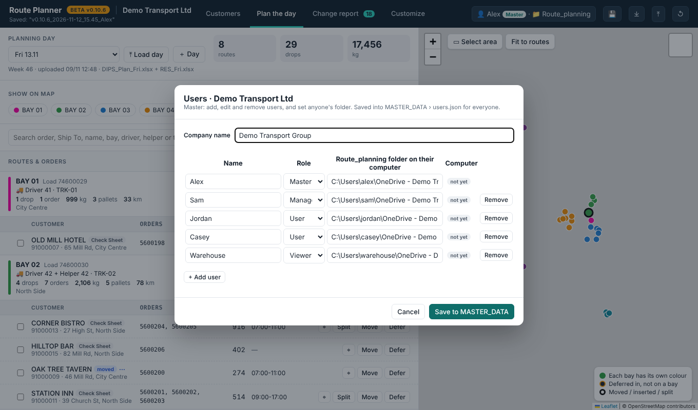

> A browser can't read a folder's full path or the Windows user. That's why the laptop registration is what ties a laptop to a person. Use **one browser** (Chrome or Edge) on your laptop: a different browser counts as a different computer.

## 2. Load reports (a planning day)

Every file type has its own folder, and only files in those folders are listed. Files anywhere else, or with unknown names, aren't shown.

| Folder | Files |
|---|---|
| `MASTER_DATA` | `MASTER_DEL_DETAILS`, `FIXED_ROUTES_DIPSDATA`, `users.json` |
| `REPORTS/week_XX` | `DIPS_Plan_<wd>`, `RES_<wd>`, `PROD_<wd>`, `UPLIFTS_<wd>`, `POD_<wd>` (older names like `Tue - 03.11.xlsx` also work) |
| `PLANS/week_XX` | saved plans (`.json`) and snapshots (`.html`) |

1. Go to **Plan the day** and click **⤒ Load day**.
2. The window opens on the **newest week** (use the week chips to switch). Each file shows its day and a tag:
   - **✓ loaded:** this exact file is in the planner.
   - **⚠ changed since loaded:** someone changed the file in the folder after it was loaded.
   - **not loaded**
3. Tick the DIPS Plan and Resources files for the days you want. You can tick several days at once, or Resources on their own to create or update a day.
4. Click **Import selected**. Check the preview (routes, drops, orders, kg, how many are on the map, and any warnings), then click **Add**.
5. **Replacing what's loaded** (a day, the customer master or the fixed routes): a window first shows **what's different**, e.g. orders added or removed, orders on another load, weight changes, and routes. It also warns how many of your changes to that day will be lost. Click **Replace and load** or **← Back**.

| Choose files | Preview |
|---|---|
| 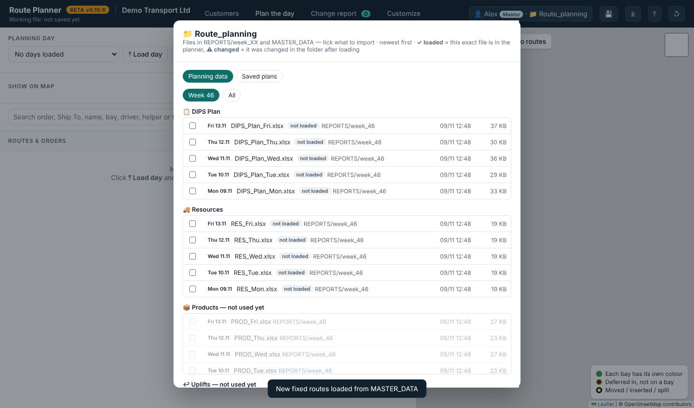 | 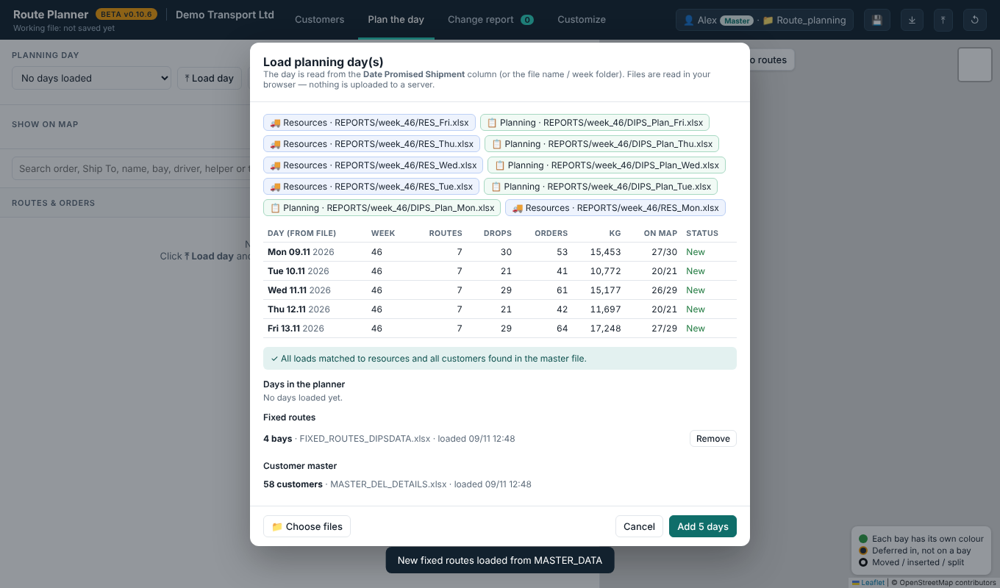 |

| A file changed in the folder | Differences before replacing |
|---|---|
| 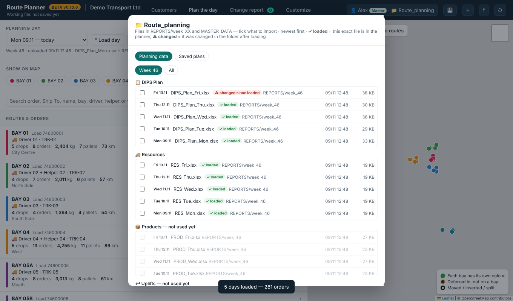 | 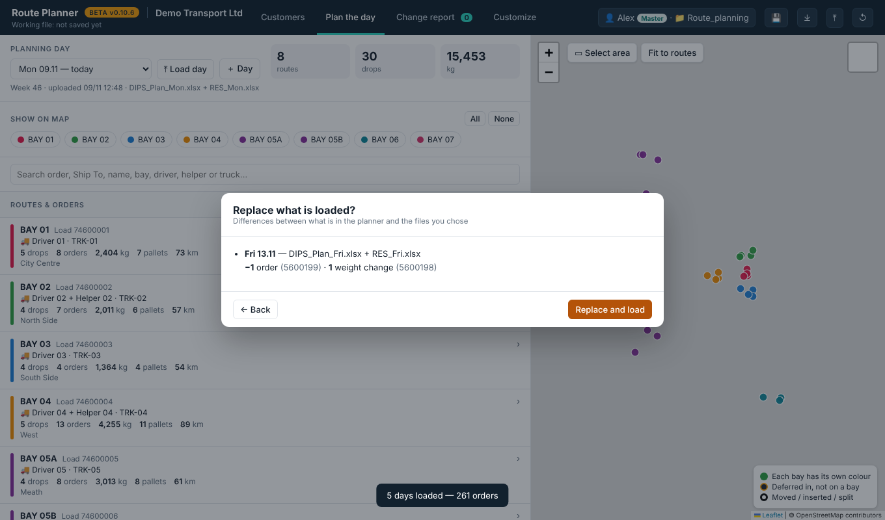 |

Every file loaded is logged in the change report under **Files loaded**: day, file, what changed, who and when. It's information only, so it isn't counted as a change in the tab's number or the boxes; its count is a flag in the section heading.

> Products, Uplifts and POD are listed but can't be imported yet. **Days in the planner…** (bottom left of the window) lists the loaded days, where you can remove one.

## 3. Open a saved plan

1. Click **⤒ Open plan** (top right).
2. Pick the week, then the plan file (`.json`) from `PLANS/week_XX`, and click **Open plan**. Only plans in `PLANS` are listed.
3. Check who saved it and when, then click **Open this plan**. It replaces what's in your planner, so save your own work first if you need it.

> A **snapshot** (`.html`) opens with a double-click on any computer, without the start window. It's strictly view-only, for people who just need to look at or print the plan.

## 4. Move orders

**One drop** (a customer on a route):

1. In **Plan the day**, open the route (or click **Expand all**).
2. Click **Move** on the drop, choose the new route, a reason and an optional note.
3. The window shows the effect on the destination bay (drops and kg). Click **Move**.

**A group:**

1. Tick the drops (or use **▭ Select area** on the map to draw around them).
2. Click **Move** in the bar at the bottom and continue as above.

| One drop | Group selected |
|---|---|
| 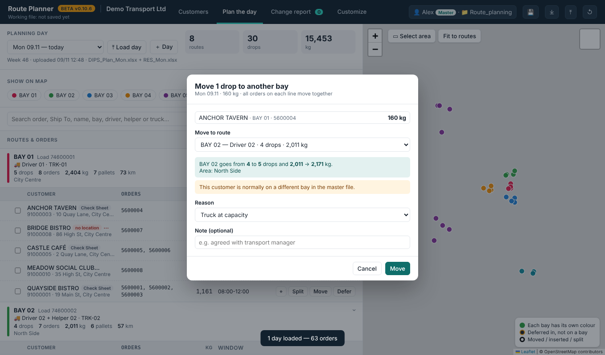 | 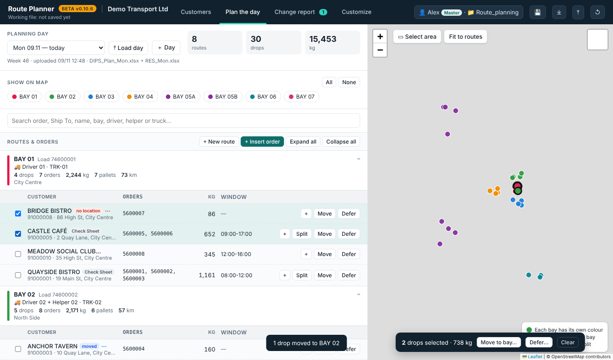 |

## 5. Defer orders

**One drop:**

1. Click **Defer** on the drop.
2. Pick the day on the calendar. Days whose files are loaded are highlighted, and the customer's usual days are marked.
3. If that day is loaded, choose a **bay** now or leave it unassigned. Add the reason, then click **Defer**.

**A group:** tick the drops, click **Defer** in the bottom bar and continue as above.

| One drop, onto a bay | Group, no bay yet |
|---|---|
| 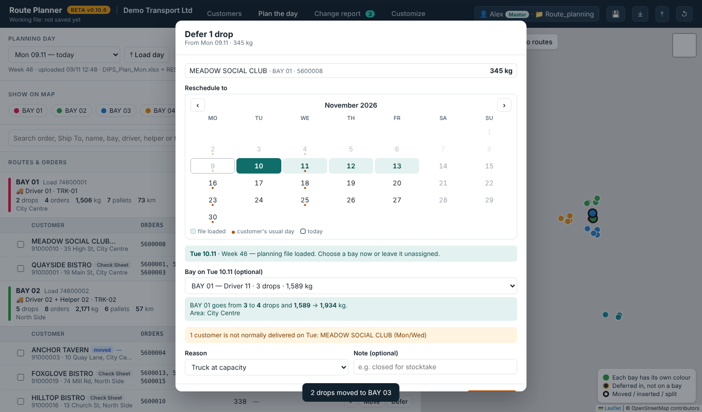 |  |

**Later:** drops deferred without a bay wait in the change report under **Deferred — not on a bay yet**. Tick them and click **Allocate**. The original line in **Deferred orders** is then updated with the day and bay they ended up on. It doesn't appear again as a reallocation.

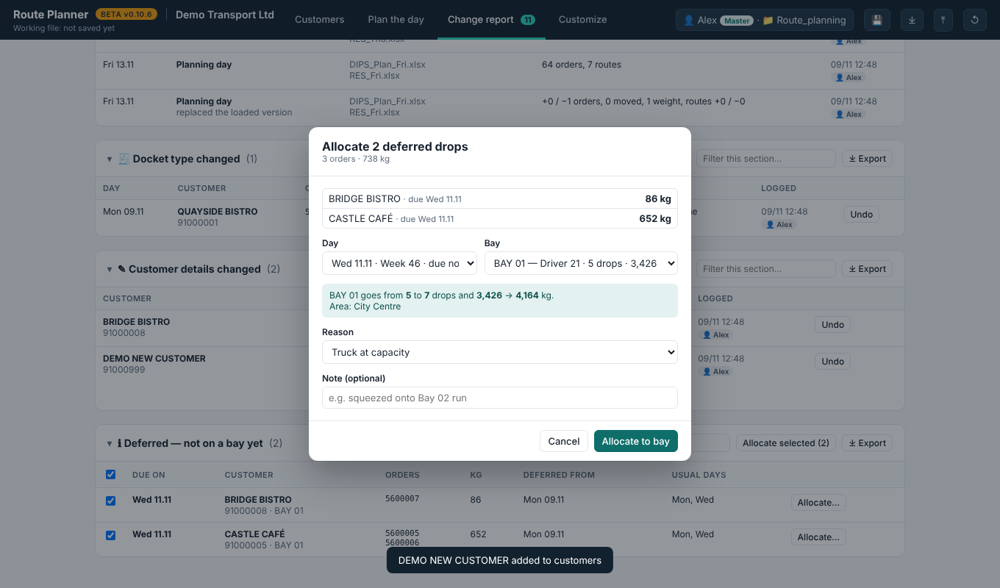

## 6. Split a customer's orders

1. Click **Split** on a drop that has more than one order.
2. Tick the orders that go on a **new line**.
3. Choose the **docket for each line** (**P&W** or **Check Sheet**, for the new line and the remaining line), then click **Split**.
4. Each line can now be moved or deferred on its own. **Merge** puts them back together.

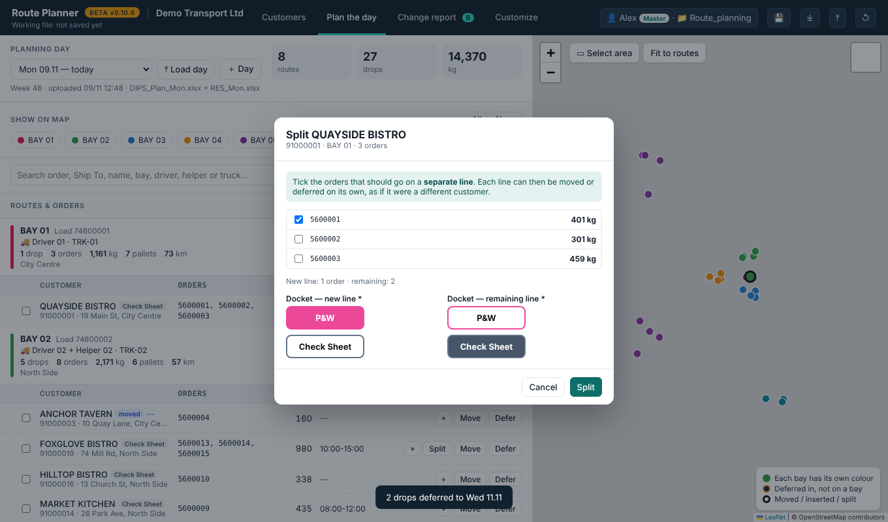

## 7. Insert an order

1. Click **+ Insert order**.
2. Enter the order number and the Ship To (type the number or start typing a name). The customer's details and usual bay fill in.
3. Choose the bay and, if you like, the weight, address and note.
4. Choose the **docket** (required): **P&W** or **Check Sheet**. The chosen button turns solid. Then click **Insert order**.

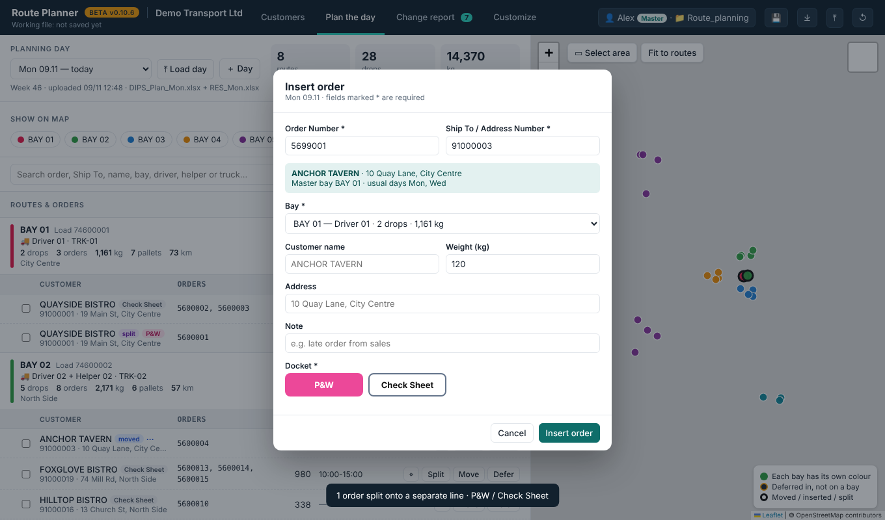

## 8. Create a route

1. Click **+ New route**.
2. Fill in bay, loading number, driver, helper and truck (required), plus pallets, km, area and note (optional).
3. Click **Add route**. It appears on the day and in the change report under **New routes**.

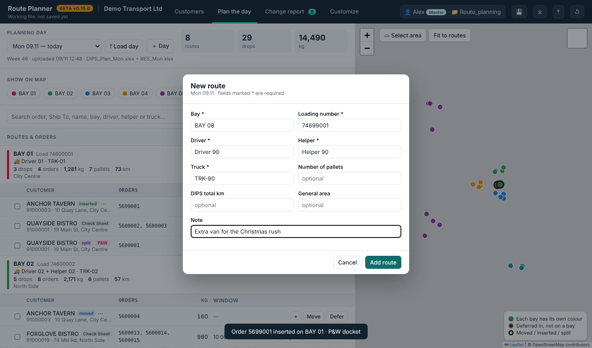

## 9. Create a new day

1. Click **＋ Day** next to the day list.
2. Pick the date. The window shows which **fixed routes** run that weekday.
3. Click **Create day**. When its DIPS Plan and Resources files arrive, load them and they fill in the same day.

## 10. Edit or add customer details

**Edit:** on the **Customers** map, click a customer and then **✎ Edit details**. Or click a customer in the list that has no location. You can change the name, address, Eircode, bay, delivery days and time window. To fix the location, type the coordinates, click the small map, drag the pin, or search the address / Eircode.

**Add:** click **+ New customer** and fill in the Ship To and details.

Customer changes are listed in the change report. The master file isn't changed, so the edits are what staff copy into the other systems.

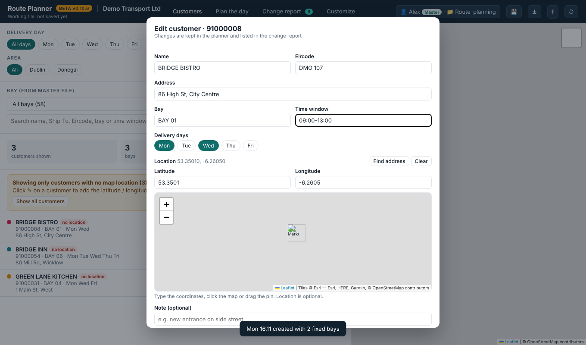

## 11. Docket type (P&W / Check Sheet)

Every order has a docket:

- **From the planning file:** always **Check Sheet**.
- **Inserted orders:** you choose when inserting (required).
- **Split lines:** you choose for each line when splitting.

The buttons: **P&W** has a pink outline and turns solid pink when chosen; **Check Sheet** has a grey outline and turns solid grey.

You can change it in the **Change report**:

- **Any order:** type the order number in the 🧾 **Docket type** box at the top and click **Change…**.
- **Orders in the tables:** click its tag (**Check Sheet** / **P&W**).

Each change is listed under **Docket type changed** and can be undone. The plan shows the tag on every line.

## 12. Change report and exporting changes

The **Change report** tab lists every change, with the order numbers staff need in order to update the other systems.

- **Sections:** Deferred, Reallocated, Inserted, New routes, **Files loaded**, Route details from RESOURCES, Docket type, Customer details and Deferred not on a bay yet.
- **Boxes at the top** show only that section (click again to show everything).
- **Search** looks across everything, including driver, helper and truck. **Filter this section** works within one section.
- **Click a column heading** to sort that section (click again to reverse).
- **Logged** shows when and **who** made each change (👤 user tag); the Excel export has a **By** column.
- **Undo** removes a change. If something happened to those orders later, undo that first.
- **⤓ Export** on a section, or the export button at the top for everything, creates an Excel file. **Print** prints the report with a signature line.

| Report | After allocating and sorting |
|---|---|
| 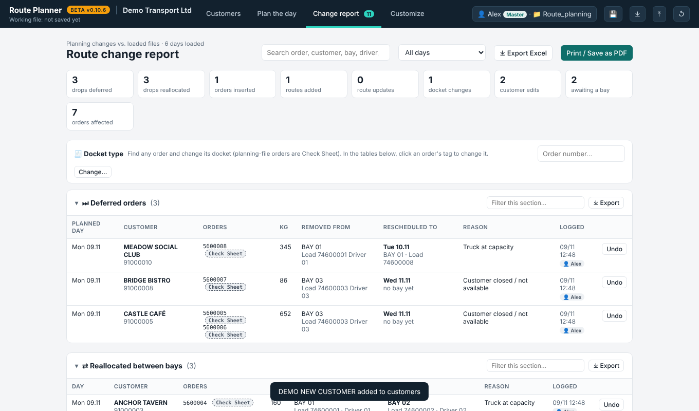 | 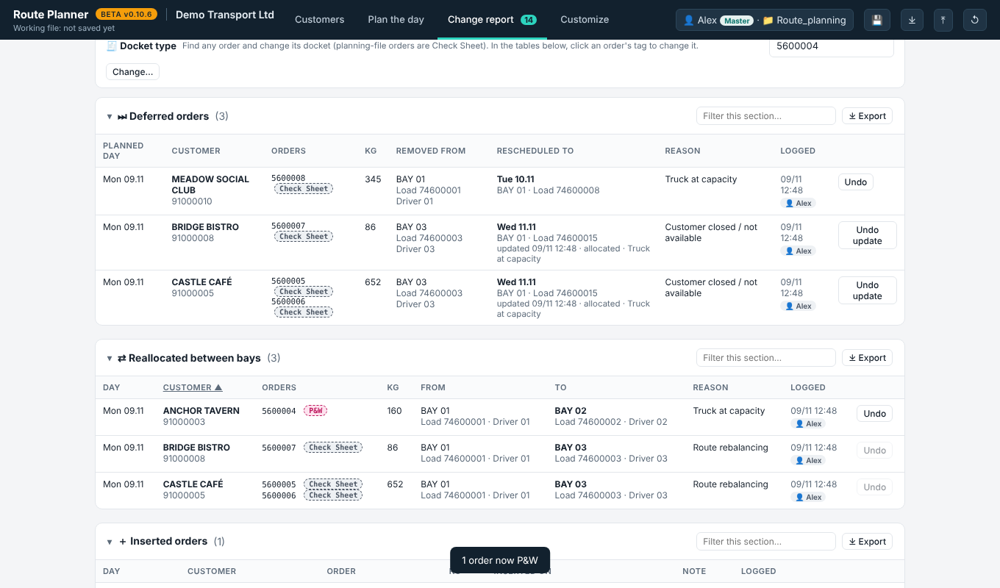 |

## 13. Save and share

- **💾 Save** (top right) saves the plan file straight into `PLANS/week_XX`, using the week of the day you're planning. The name is `version_date_time_user`, e.g. `v0.10.0_2026-11-06_16.05_Alex.json`.
- **⤓ Save as / share** gives two options:
  - **Plan file (.json):** for planners who'll keep working on it. **Save**, or **Save as…** to choose another **folder**. The file name is always `version_date_time_user` and can't be changed, and "saved by" is the user who is in.
  - **Snapshot (.html):** a view-only copy anyone can open with a double-click.
- The line under the app name shows the file you're working on. Click it to see the history (each file remembers the one it was based on).

**↺ Reset** (Master and Manager) clears the **planner** on this laptop:
- the plan and loaded days;
- customer edits;
- the customer master and fixed routes, which are read again from `MASTER_DATA` as soon as you continue.

The company folder link and the users file are **kept**, and the laptop stays registered to its owner. The app goes straight back to **Who is planning?**. Files in the shared folder aren't touched, so save first if you want to keep the plan.

## 14. Customize (Master only)

The **Customize** tab is only visible to Master users. Changes are saved with the plan.

- **Bay colours:** pick a colour for each bay, used on both maps and the route list. **Default** goes back to the automatic colour.
- **Route names for one day:** give a route a name for one day only, e.g. "City Express" instead of BAY 01.

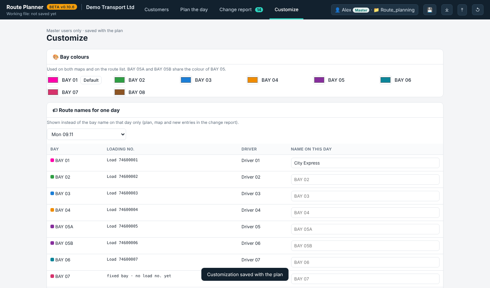

## 15. Roles: who can do what

| | Master | Manager | User | Viewer |
|---|:-:|:-:|:-:|:-:|
| View plans, maps and report; print and export | ✅ | ✅ | ✅ | ✅ |
| Load days, move, defer, split, insert, routes, days, customers, dockets, save | ✅ | ✅ | ✅ | — |
| Undo, remove days or fixed routes, reset | ✅ | ✅ | — | — |
| Manage users (roles) | ✅ | ✅ Users and Viewers only; can't add users | — | — |
| Set the folder path of… | anyone | themselves, Users and Viewers | themselves | themselves |
| Unregister someone's laptop | anyone else | Users and Viewers | — | — |
| Add or remove users | ✅ | — | — | — |
| Customize tab | ✅ | — | — | — |

A **Viewer** sees the planner like a snapshot, with no editing buttons. Roles are guardrails for this prototype, not security; see [backend-blueprint.md](backend-blueprint.md).

| Viewer | Manage users (Manager) |
|---|---|
| 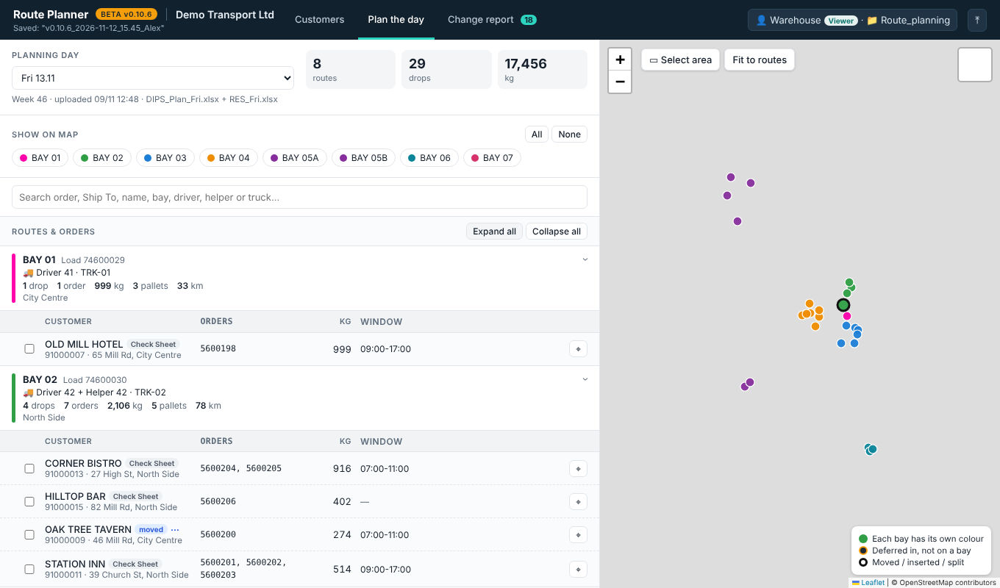 | 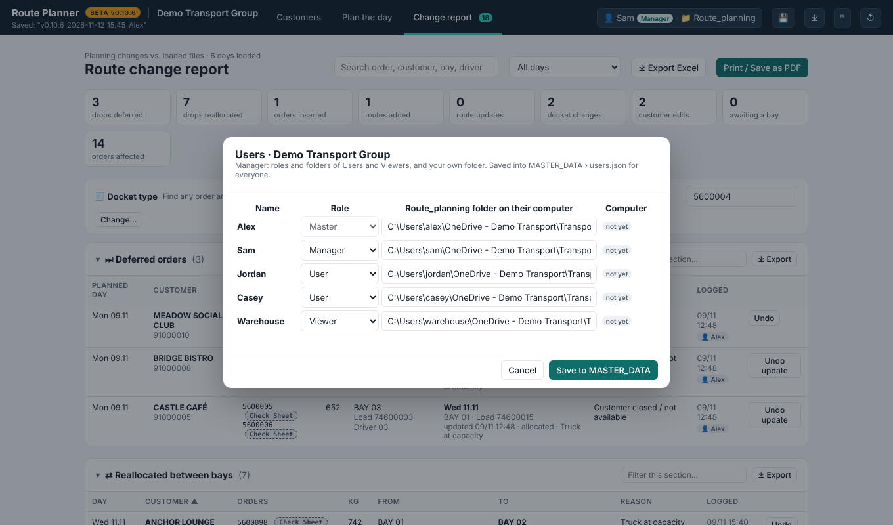 |
